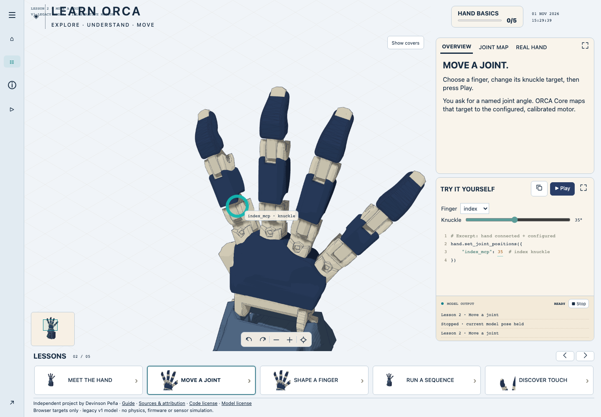

# Learn ORCA

Five interactive browser lessons exploring an open robotic hand model. Move one
joint, shape a finger, run a sequence, and learn why commanded movement and
measured feedback are different.

Independent educational work by Devinson Peña. Not an official ORCA product.



## Run locally

Requires Node.js, npm, Python 3, and a browser with WebGL.

```sh
npm ci
npm test
npm run dev
```

Open http://127.0.0.1:8974. No robot or account is required. The optional
manufacturer recording is fetched from an external host when opened.

## Learn from the implementation

| File                 | What to inspect                                            |
| -------------------- | ---------------------------------------------------------- |
| `lesson-content.mjs` | Explanations, example commands and official source links   |
| `app.entry.js`       | URDF loading, picking, camera control and lesson interface |
| `playback.mjs`       | Elapsed-time playback, pause/resume and scene presets      |
| `playback.test.mjs`  | Reproducible timing checks                                 |
| `model/SOURCE.json`  | Pinned upstream model and local changes                    |

## What I learned

- Joint targets become easier to understand when the control, code example and
  visible model agree.
- Pause must freeze elapsed motion and waiting time; merely stopping a render
  loop can give the learner a misleading sequence.
- Camera movement, assembly illustrations and commanded poses are distinct
  behaviors. Resetting a view should not silently reset the learner’s pose.
- Touch adds measured information on real hardware. A browser animation cannot
  honestly manufacture that evidence.

Try modifying the wait between two commands, then test pause/resume behavior.
Compare the code highlight, output order and visible movement.

## Evidence and attribution

This is a legacy v1 assembly viewer, not physics, firmware, motor/tendon or sensor
simulation. Python shown is illustrative and is not executed. Current hardware
may differ. No real hand performance is established by these lessons.

The model is from [ORCA’s open description repository](https://github.com/orcahand/orcahand_description)
at the revision in `model/SOURCE.json`; its MIT notice is in `model/LICENSE`.
The learning interface was inspired by [Learn Arduino by Dilum Sanjaya](https://learn-arduino-red.vercel.app/).

Code and original interface artwork are MIT-licensed. Upstream model notices are
retained separately. Captured reference artwork and font files are excluded;
see [third-party notices](THIRD_PARTY_NOTICES.md) for sources and boundaries.

## Contribute and verify

Read [the architecture](ARCHITECTURE.md) and [contributor guide](CONTRIBUTING.md).
Run `npm run verify` for source scanning, formatting, playback tests and the build.
Run `npx playwright install chromium` once, then `npm run test:e2e` for desktop
and mobile lesson flows. CI runs these same checks. Tests establish application
behavior, not robot safety or physical performance.
